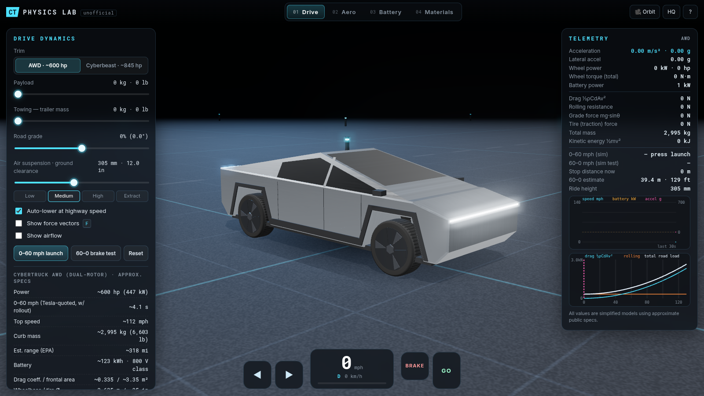
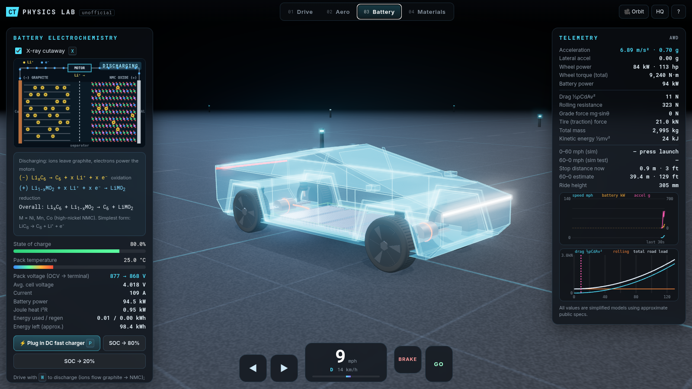
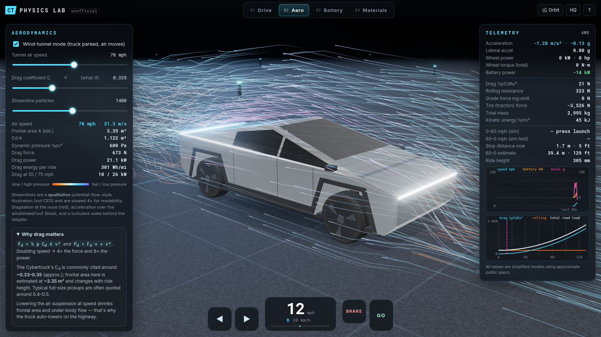
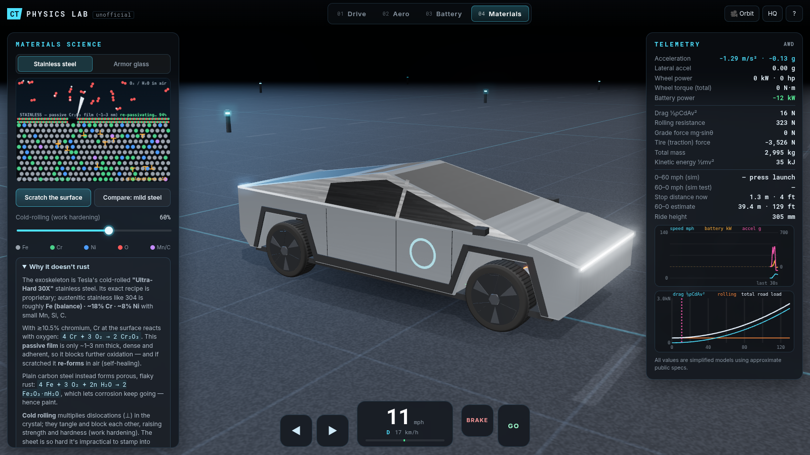

# Cybertruck Physics & Chemistry Lab

An interactive 3D Cybertruck in the browser that shows **the physics and chemistry behind the truck**: drive dynamics, aerodynamics, the 4680 lithium-ion battery pack, and the materials science of the stainless-steel body and armor glass.

**▶ Live demo: https://russellambriz.github.io/cybertruck-physics-lab/**



| Battery x-ray | Aerodynamics | Materials |
|---|---|---|
|  |  |  |

> **Unofficial fan/educational project.** It isn't affiliated with or endorsed by Tesla. The truck is built procedurally from simple geometry in code (no downloaded or copyrighted 3D models). Every spec and model here is **approximate** and simplified for learning.

## Features

### 🚙 Procedural 3D model (Three.js)
- A faceted stainless "exoskeleton" built from an extruded side profile plus a hand-built greenhouse prism: a triangular roofline, tumblehome sides, sail pillars and the tonneau-covered bed
- Front and rear light bars (with bloom), dark armored-glass windows, arch cladding, mirrors and panel seams
- 35-inch tires with tread and spinning aero covers. The front wheels steer with Ackermann-style angles.
- Air-spring + damper suspension that stretches and compresses with ride height, pitch and roll
- Brushed-stainless PBR material lit by a PMREM `RoomEnvironment`, soft shadows, ACES tone mapping, bloom
- OrbitControls with damping and smooth camera fly-to presets (Orbit / Chase / Side / Top / Front)

### ⚙️ Physics: Drive mode
- Longitudinal model: `m·a = F_traction − ½ρC_dAv² − C_rr·m·g·cosθ − m·g·sinθ − F_brake`
- Traction is limited by motor force at low speed, by power (`F = P/v`) at high speed, and by tire grip (`μN`)
- Trims: **AWD (~600 hp)** and **Cyberbeast (~845 hp)**, with sliders for **payload**, **towing mass**, **road grade** (the whole scene tilts) and **air-suspension ride height** (Low / Medium / High / Extract, plus auto-lower at highway speed)
- Body **pitch and roll from weight transfer** (`ΔN = m·a·h/L`), using a damped spring model
- Kinematic bicycle steering with a grip-limited lateral acceleration
- One-pedal regen, blended brakes, reverse, auto-hold, top-speed limiter
- **0–60 mph launch test** and **60–0 mph brake test** buttons
- Live telemetry: speed, acceleration (g), wheel power, wheel torque, battery power, drag, rolling resistance, grade force, tire force, kinetic energy, stopping distance and ride height
- Charts: a 30-second speed/power/accel history and a **road-load vs speed** plot (drag, rolling and total)
- Optional **force vectors** (gravity, front/rear normal loads, drag, tire force, rolling resistance) with kN labels

### 🌬️ Aerodynamics mode
- About 1,100 animated streamlines whose speed scales with vehicle or wind-tunnel speed. They show stagnation at the nose, flow speeding up over the windshield and roof, and a turbulent wake behind the tailgate.
- A what-if C_d slider. Live Cd·A, dynamic pressure, drag force, drag power and drag Wh/mi.
- A qualitative illustration only, **not CFD**

### 🔋 Battery chemistry mode
- **X-ray cutaway** that reveals about 1,336 instanced 4680-style cells in the floor pack, the drive units (1 rear motor on AWD, 2 on Cyberbeast), and orange HV cables with animated current flow
- **Animated Li-ion cell**: Li⁺ ions leave graphite for the NMC layered oxide while you drive (discharge) and go back during regen braking or DC fast charging. Electrons flow through the external circuit.
- Live half-reactions:
  - (−) `LiₓC₆ → C₆ + x Li⁺ + x e⁻` (oxidation on discharge)
  - (+) `Li₁₋ₓMO₂ + x Li⁺ + x e⁻ → LiMO₂` (M = Ni, Mn, Co)
- SOC, OCV vs terminal pack voltage (800-V class), current, power, **I²R heat**, and a pack thermal model with liquid cooling. The cells are color-coded by temperature.
- A DC fast-charge button with a charge taper (40× time-lapse)

### 🧪 Materials mode
- **Stainless steel**: an animated Fe–Cr–Ni lattice with the ~1–3 nm **Cr₂O₃ passive film**. Scratch it and watch it re-passivate. You can compare it with mild steel, which grows porous rust. A cold-rolling slider adds dislocations to show work hardening.
- **Armor glass**: an illustrative laminated cross-section (glass plies + PVB-type interlayers) with an impact test

### 🖥️ UI
- A dark, futuristic HUD with mode tabs, a loading screen, a help overlay, toasts and responsive panels
- Mobile-friendly: touch pedals and steering pads, bottom-sheet panels, and a lower-quality render mode chosen automatically
- Adaptive quality: if the first seconds run below about 40 fps, it drops to LQ (no bloom, smaller shadow map, DPR 1.25). Otherwise DPR is capped at 2.

## Controls

| Action | Keyboard | Touch / mouse |
|---|---|---|
| Accelerate | `W` / `↑` | **GO** pad |
| Brake (hold at a stop to reverse) | `S` / `↓` | **BRAKE** pad |
| Steer | `A` `D` / `←` `→` | ◀ ▶ pads |
| Hard brake | `Space` | |
| Modes | `1` Drive · `2` Aero · `3` Battery · `4` Materials | tabs |
| Force vectors / X-ray | `F` / `X` | checkboxes |
| Camera presets | `C` | 🎥 button |
| 0–60 / 60–0 test | `L` / `B` | buttons |
| Plug in charger | `P` | button |
| Reset / Help | `R` / `H` | `?` |
| Orbit / zoom / pan | | drag / scroll or pinch / right-drag |

URL options: `?mode=battery|aero|materials`, `?mat=glass`, `?forces`, `?q=low|high`, `?nohelp`.

## Run locally

This is a no-build static site. Three.js r169 loads from the jsDelivr CDN via an import map.

```bash
git clone https://github.com/russellambriz/cybertruck-physics-lab.git
cd cybertruck-physics-lab
python3 -m http.server 8000      # or: npx serve .
# open http://localhost:8000
```

(ES modules need to be served over HTTP, so opening `index.html` straight from disk won't work.)

### Headless smoke test and screenshots

```bash
npm i playwright-core
CHROME_PATH=/usr/bin/google-chrome node tools/screenshots.mjs http://127.0.0.1:8000/ screenshots
```

## Project layout

```
index.html        HUD markup + import map
style.css         dark HUD styling, responsive/mobile layout
src/main.js       renderer, scene, camera, input, modes, UI wiring, frame loop
src/truck.js      procedural Cybertruck geometry, wheels, suspension
src/physics.js    vehicle dynamics + battery electro-thermal model, trim specs
src/airflow.js    streamline particle field
src/battery.js    3D 4680 pack, motors, HV cable current flow
src/chem2d.js     canvas animations: Li-ion cell, stainless lattice, laminated glass
src/charts.js     telemetry charts
tools/            headless screenshot/smoke-test script
```

## Approximate specs and assumptions used

| Item | Value (approx.) |
|---|---|
| Curb mass | AWD ~2,995 kg (6,603 lb) · Cyberbeast ~3,104 kg (6,843 lb) |
| Power | AWD ~447 kW (600 hp) · Cyberbeast ~630 kW (845 hp) |
| Tesla-quoted 0–60 | AWD ~4.1 s · Cyberbeast ~2.6 s (with 1-ft rollout). The sim gives roughly 4.0 s and 2.9 s. |
| Top speed | ~112 / ~130 mph |
| Drag coefficient / frontal area | C_d ~0.335 (commonly cited 0.33–0.35) / ~3.35 m² (estimate) |
| Wheelbase / tire | ~3.635 m / ~35 in (r ≈ 0.44 m) |
| Battery | ~123 kWh, 800-V class, ~1,336 4680 cells. Modeled as 216 series cells with 0.08 Ω effective resistance (assumed). |
| Other assumptions | C_rr 0.011, μ 1.0, braking ~0.92 g, regen ≤250 kW, drivetrain efficiency 90%, CG height 0.72 m |

These are simplified educational models. Real vehicle behavior depends on many factors not modeled here: tire slip, motor maps, battery temperature limits, and real aerodynamics.

## License

[MIT](LICENSE). Not affiliated with Tesla, Inc. "Cybertruck" is a trademark of its owner and is used here only descriptively.
